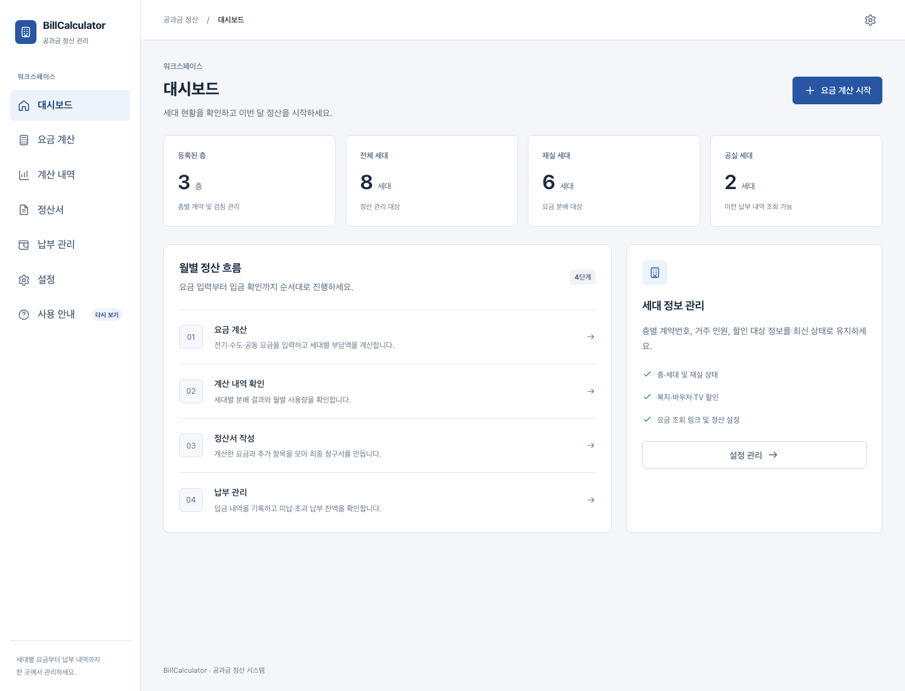
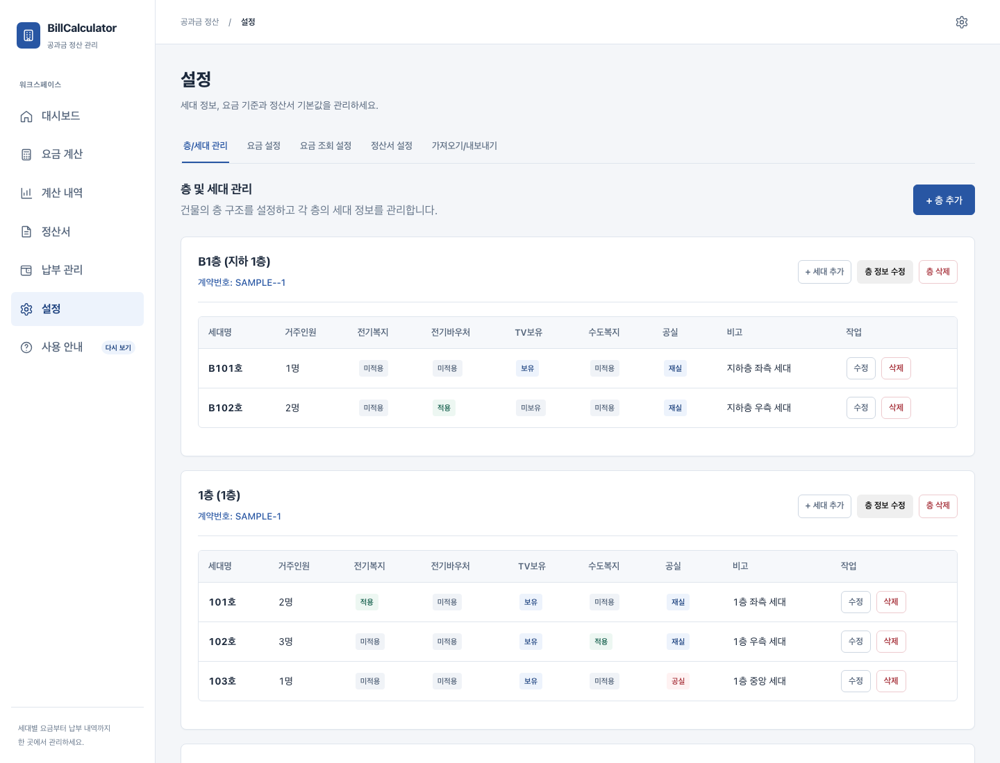
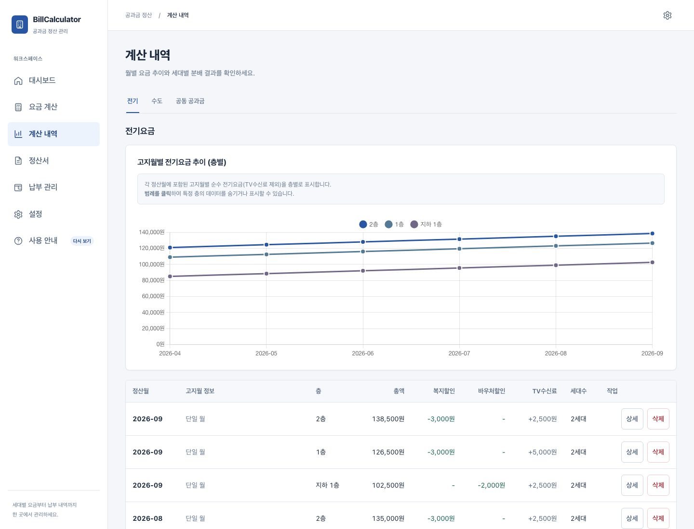
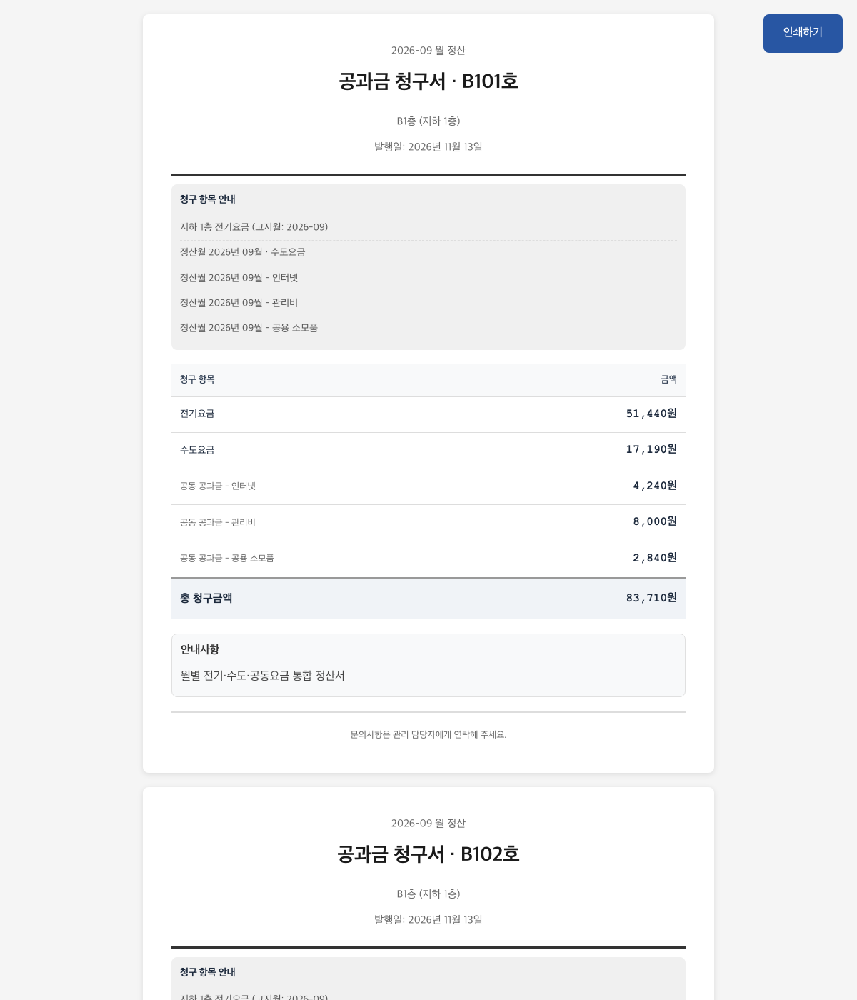

# BillCalculator

> 층별로 한 장만 나오는 전기요금을 세대별 계량기 사용량에 따라 나누고, 수도·공동요금·정산서·납부 내역까지 관리하는 다세대·다가구 주택용 공과금 정산 앱

[최신 버전 다운로드](https://github.com/InFinity-dev/BillCalculator/releases/latest) · [상세 소개와 사용 방법](docs/blog/billcalculator-v1-introduction.md) · [개발자 문서](docs/development.md)

## 이런 문제를 해결합니다

한 층에 전기요금 고지서는 한 장만 나오지만 실제로는 여러 세대가 함께 살고 있다면, 매월 세대별 검침값을 확인해 전기요금을 다시 나눠야 합니다.

BillCalculator는 다음과 같은 건물 관리 상황을 위해 만들었습니다.

- 층별 전기 계약 아래 여러 세대가 있어 고지 금액을 다시 나눠야 하는 경우
- 각 세대의 전월·당월 계량기 검침값으로 실제 사용량을 계산하는 경우
- 전기는 매월, 수도는 2개월 단위로 고지되어 청구 기간이 서로 다른 경우
- 여러 층과 서로 다른 정산월의 계산 결과를 한 정산서로 묶어야 하는 경우
- 세입자별 청구서, 입금액, 미납·초과납부 잔액을 함께 관리해야 하는 경우

단순 가구 수 균등 분배뿐 아니라 세대별 사용량과 거주 인원, 재실·공실 상태, 복지할인·바우처·TV 수신료 조건까지 반영할 수 있습니다.

## 주요 기능

### 층·세대 관리

층별 전기 계약번호와 세대명, 거주 인원, 공실 여부, 할인 대상 정보를 등록합니다. 이후 세입자가 바뀌어도 이미 발행된 과거 정산서는 당시의 세대·층 정보를 그대로 보존합니다.

### 전기·수도·공동요금 계산

- 전월·당월 검침값의 차이로 세대별 전기 사용량 계산
- 층 전체 사용량에서 차지하는 비율에 따라 전기요금 분배
- 복지할인, 바우처, TV 수신료 정책 적용
- 건물 전체 수도요금과 수도 복지할인 분배
- 인터넷·관리비·공용 소모품 등을 세대 수 또는 거주 인원 기준으로 분배
- 저장 전 세대별 부담액과 예외사항 미리보기

### 여러 계산월을 하나의 정산서로 묶기

전기요금은 매월 나오더라도 실제 세입자 청구주기는 더 길 수 있습니다. 예를 들어 9월·10월 전기요금과 9~10월 사용분 수도요금, 10월 공동요금을 하나의 10월 정산서로 묶을 수 있습니다.

선택한 계산월의 지하층·1층·2층 등 모든 대상 층을 함께 반영하고, 각 원본 계산의 정산월은 그대로 보존합니다.

### 세대별 정산서 인쇄와 납부 관리

세대별 전기·수도·공동요금, 기타 항목과 이월액을 합산해 배부용 청구서를 만듭니다. 종이로 인쇄하거나 PDF로 저장할 수 있으며, 입금 등록 후 완납·부분 납부·미납·초과납부 상태를 확인할 수 있습니다.

### 백업과 부분 복원

- 설정과 전체 업무 데이터를 JSON 파일로 내보내기
- 전체 데이터, 주택 구성과 전체 이력, 층·세대, 정산 데이터, 앱 설정 중 복원 범위 선택
- 삭제·덮어쓰기·복원 전 자동 복원 지점 생성
- 선택한 범위를 백업 내용으로 교체하고 선택하지 않은 범위는 현재 상태 유지

복원은 기존 행에 데이터를 덧붙이는 병합 방식이 아닙니다. 선택한 복원 범위 전체를 백업 파일의 내용으로 교체합니다.

## 사용 흐름

1. **설정**에서 층과 세대를 등록합니다.
2. **요금 계산**에서 전기 고지액과 세대별 검침값을 입력합니다.
3. 수도요금과 공동요금이 있다면 함께 계산합니다.
4. **계산 내역**에서 월별 결과와 세대별 분배액을 확인합니다.
5. 필요한 계산 결과를 선택해 하나의 **정산서**를 만듭니다.
6. 세대별 정산서를 인쇄하거나 PDF로 전달합니다.
7. **납부 관리**에서 입금과 누적 잔액을 관리합니다.

처음 실행하면 실제 데이터와 분리된 연습용 데이터로 전체 흐름을 따라 해볼 수 있습니다. 튜토리얼을 완료하거나 연습을 종료하면 데모 데이터는 정리되고 실제 주택 정보를 입력할 수 있는 상태로 돌아갑니다.

## 다운로드

[GitHub Releases의 최신 버전](https://github.com/InFinity-dev/BillCalculator/releases/latest)에서 사용하는 컴퓨터에 맞는 파일을 받으세요.

| 사용하는 컴퓨터 | 받을 파일 형식 |
|---|---|
| Windows 10/11 64비트 | `BillCalculator-Setup-1.X.X-Windows-x64.exe` |
| Apple Silicon Mac | `BillCalculator-1.X.X-macOS-arm64.dmg` |
| Intel Mac | `BillCalculator-1.X.X-macOS-x64.dmg` |

Mac은 **Apple 메뉴 → 이 Mac에 관하여**에서 `칩: Apple M…`이면 Apple Silicon용, `프로세서: Intel…`이면 Intel용 파일을 선택합니다. macOS 13 이상을 지원합니다.

현재 배포본에는 Windows 코드 서명과 Apple 공증이 적용되지 않아 첫 실행 시 운영체제 경고가 표시될 수 있습니다. 반드시 공식 GitHub Release에서 받은 파일인지 확인한 뒤, 해당 Release의 설치 안내에 따라 실행을 허용하세요.

## 데이터 보관 방식

BillCalculator는 온라인 계정이나 외부 DB 서버 없이 동작하는 로컬 데스크톱 앱입니다. 입력한 주택·세대·정산 데이터는 사용자의 컴퓨터 안에 저장됩니다.

- Windows: `%APPDATA%\BillCalculator\data\bill_calculator.db`
- macOS: `~/Library/Application Support/BillCalculator/data/bill_calculator.db`

프로그램 제거 시 업무 데이터를 자동 삭제하지 않습니다. 실제 정산을 시작한 뒤에는 **설정 → 가져오기/내보내기**에서 전체 백업을 정기적으로 별도 보관하세요.

## 더 자세히 보기

- [화면별 제품 소개와 자세한 사용 방법](docs/blog/billcalculator-v1-introduction.md)
- [Electron 데스크톱 앱 설치·빌드·배포](docs/desktop-distribution.md)
- [현재 구현 상태와 Ground Truth](docs/refactoring/CURRENT_STATE.md)
- [도메인 지식 베이스](BillCalculator_Knowledge_Base.md)
- [기능 과제와 검증 기록](TODO.md)

## 개발자 문서

소스 실행, 데모 데이터, 환경 변수, 데이터베이스 이전과 테스트 방법은 사용자용 소개와 분리했습니다.

- [개발 환경과 프로젝트 구조](docs/development.md)
- [기여 방법](CONTRIBUTING.md)
- [데이터베이스 설계·이전·테스트 문서](docs/refactoring/database/)
- [리팩터링 전 코드베이스 분석](docs/codebase-analysis/)

## 사용 범위

BillCalculator는 임대인·건물 관리자의 내부 공과금 배분과 기록을 돕는 도구입니다. 전력회사·수도사업소가 발행한 공식 고지서나 법적 증빙을 대체하지 않습니다. 실제 청구 기준과 임대차 계약 내용을 확인한 뒤 사용하세요.

소스 웹앱에는 사용자 인증이 없으며 로컬 단독 사용을 전제로 합니다. 외부 네트워크에 직접 공개하지 마세요.
