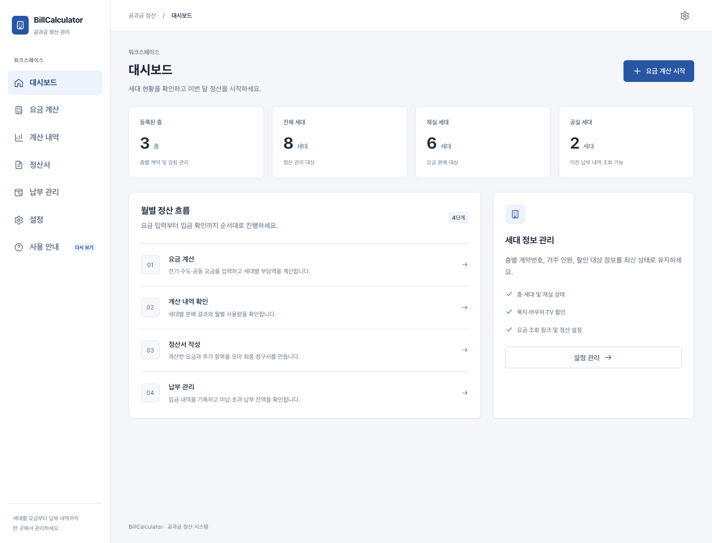
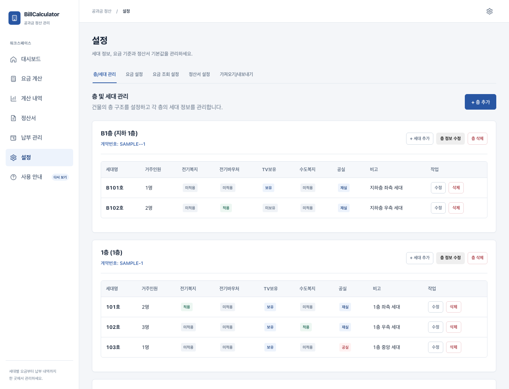
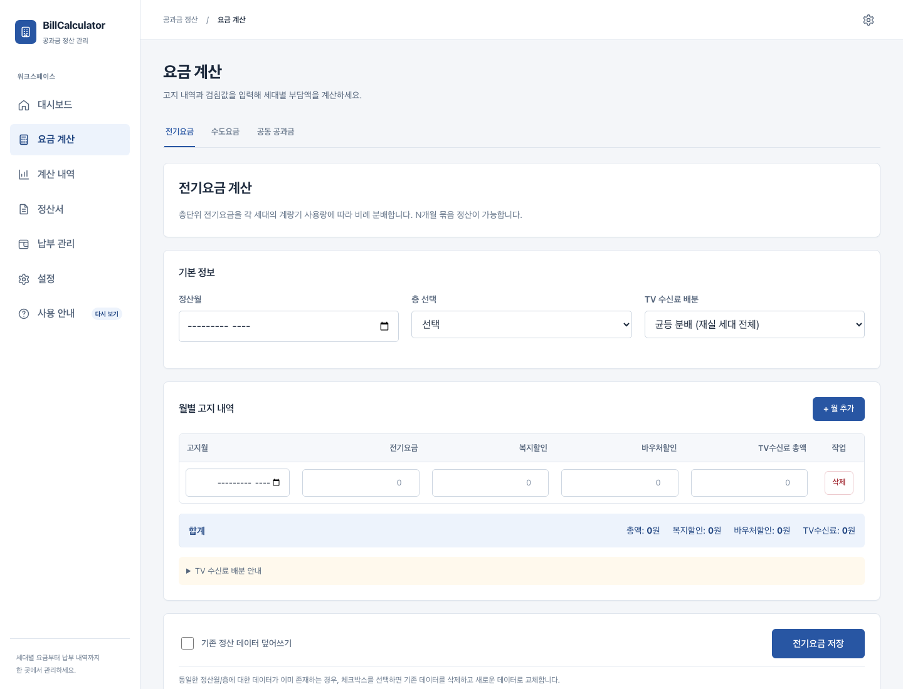
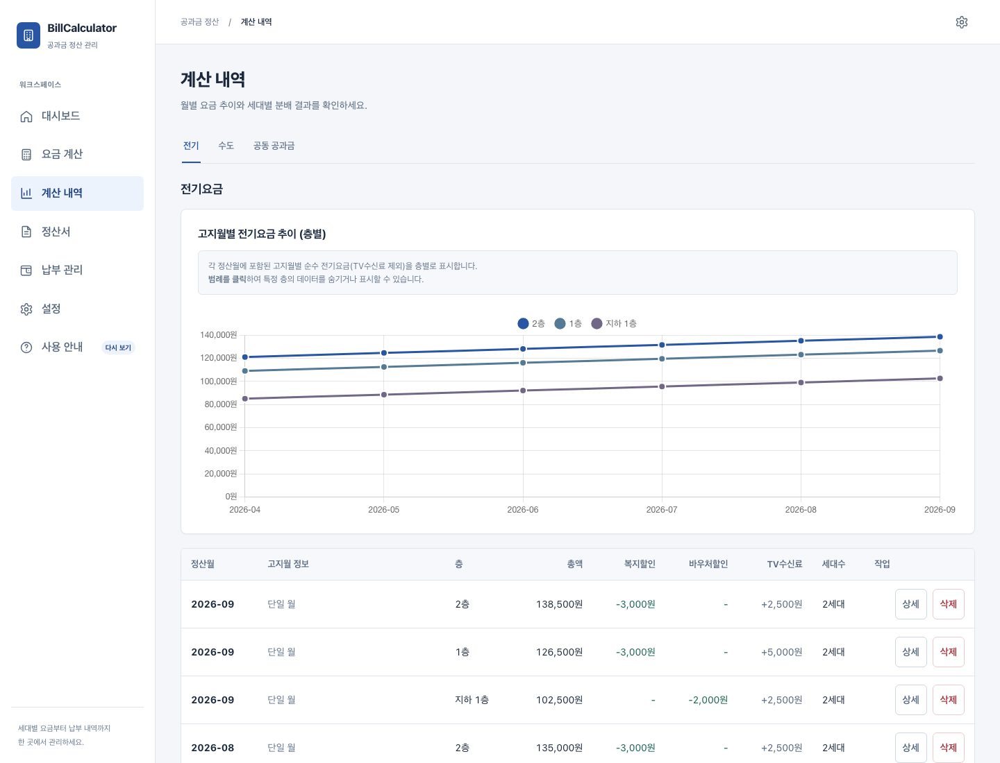
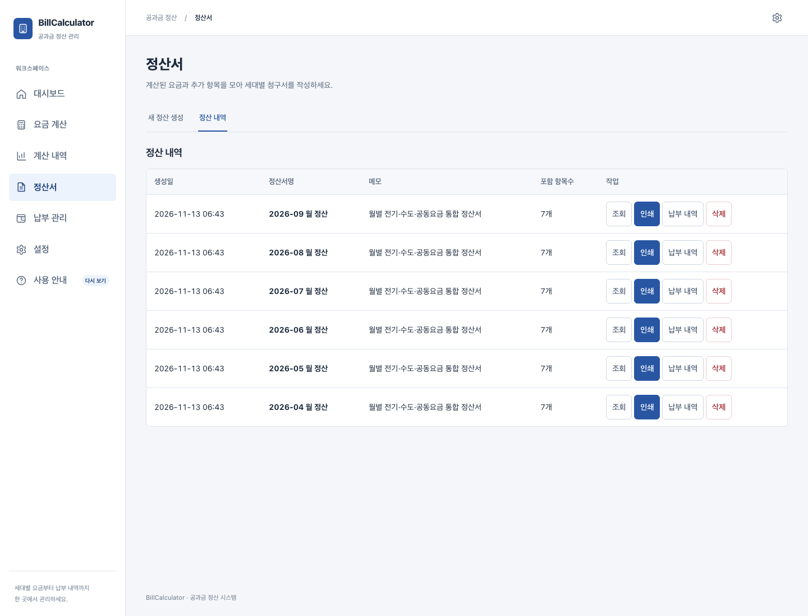
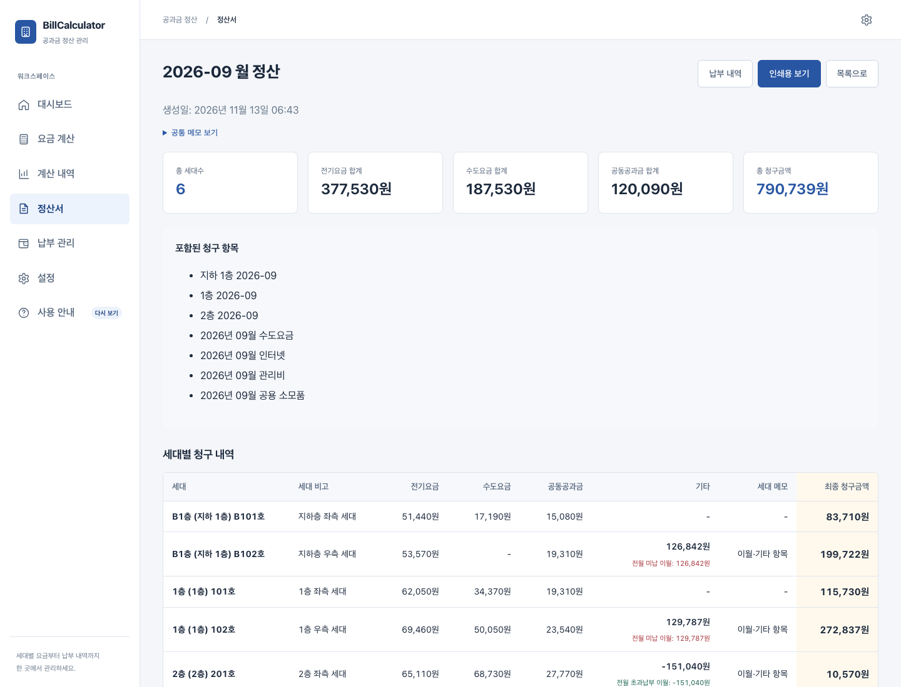
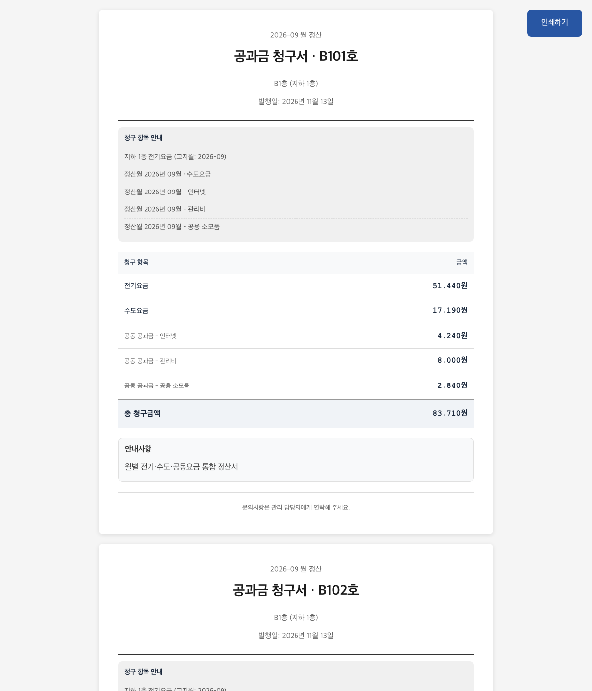
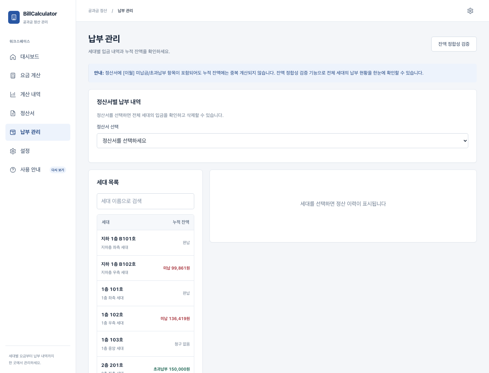

<!--
SEO 제목: 다세대 주택 전기세 나누기｜층별 전기요금을 세대별로 계산하는 BillCalculator
메타 설명: 층별로 한 장만 나오는 전기요금을 여러 세대의 검침 사용량에 따라 나누고, 수도세·공동요금·정산서·납부 내역까지 관리하는 Windows·Mac 프로그램 BillCalculator를 소개합니다.
권장 슬러그: /multi-family-electric-bill-calculator
대표 키워드: 다세대 주택 전기세 계산, 층별 전기요금 세대별 분배, 다가구 전기세 나누기
보조 키워드: 전기 계량기 검침 계산, 세입자 전기요금 정산, 원룸 공과금 계산, 수도세 분배, 임대인 공과금 관리, 다세대 공과금 정산 프로그램
권장 태그: 다세대주택, 전기세요금계산, 전기요금분배, 공과금정산, 임대관리, 세입자관리, 수도세분배, BillCalculator
대표 이미지: ./images/01-dashboard.png
-->

# 다세대 주택 전기세 나누기, 층별 고지서를 세대별로 계산하는 BillCalculator

한 층에 전기요금 고지서는 한 장만 나오는데, 실제로는 두세 가구가 함께 살고 있다면 매달 같은 고민이 생깁니다.

> “이번 달 1층 전기요금 18만 원을 101호와 102호가 얼마씩 내야 할까?”

단순히 가구 수로 똑같이 나누면 쉽지만, 한 세대가 전기를 훨씬 많이 쓴 달에는 공정하지 않습니다. 그렇다고 세대별 계량기 숫자를 매번 엑셀에 옮기고, 전월 검침값을 빼고, 할인과 TV 수신료까지 다시 계산하는 일도 번거롭습니다. 수도요금은 2개월 단위로 나오고 전기요금은 매월 나오기 때문에 청구 주기가 다르면 정산표는 더 복잡해집니다.

**BillCalculator**는 이런 다세대·다가구 주택의 공과금 정산을 위해 만든 Windows·Mac용 프로그램입니다. 층별로 청구된 전기요금을 각 세대의 실제 계량기 사용량에 따라 나누고, 수도세와 공동요금까지 더해 세대별 정산서를 만들 수 있습니다.

## 이런 건물이라면 특히 유용합니다

BillCalculator는 다음과 같은 상황을 기준으로 설계했습니다.

- 건물 전체가 아니라 **층별로 전기 계약과 고지서가 구분**되어 있습니다.
- 한 층에는 여러 세대가 살지만, 전력회사 고지서에는 세대별 금액이 나뉘어 있지 않습니다.
- 각 세대에는 사용량을 확인할 수 있는 보조 계량기 또는 검침 기록이 있습니다.
- 임대인이나 건물 관리자가 전월·당월 검침값을 비교해 전기요금을 나눠야 합니다.
- 전기요금은 매월, 수도요금은 2개월마다 나와 서로 다른 기간의 요금을 한 번에 청구하기도 합니다.
- 계산 결과를 세입자에게 보여줄 정산서와 납부 내역이 필요합니다.

예를 들어 1층 전기 고지서가 180,000원이고, 101호가 120kWh, 102호가 80kWh를 사용했다면 두 세대의 사용 비율은 60%와 40%입니다. BillCalculator는 전월과 당월 검침값으로 각 세대 사용량을 구하고, 층별 고지 금액을 그 비율에 맞춰 나눕니다.

복지할인이나 바우처, TV 수신료처럼 세대별 조건이 다른 항목도 함께 관리할 수 있습니다. 할인액이 배분 가능한 금액보다 큰 경우에는 해당 항목을 0원까지만 낮추고, 남은 할인액을 다른 세대에 임의로 넘기지 않습니다.

## BillCalculator로 할 수 있는 일

### 1. 층과 세대 정보를 한 번만 등록

건물의 층, 층별 전기 계약번호, 세대명, 거주 인원과 재실·공실 상태를 등록합니다. 전기 복지할인, 바우처, TV 보유 여부, 수도 복지 대상 여부도 세대별로 설정할 수 있습니다.

세대가 입주하거나 퇴거하면 설정 화면에서 상태를 바꿀 수 있습니다. 변경된 세대 정보는 이후 계산부터 반영되며, 이미 확정된 과거 정산서는 당시의 세대명과 층 정보를 그대로 보존합니다.

### 2. 전월·당월 계량기 검침값으로 전기 사용량 계산

전기요금 계산 화면에서 정산월과 층을 선택한 뒤, 전기 고지서의 총액과 세대별 계량기 값을 입력합니다.

기본 사용 순서는 다음과 같습니다.

1. 정산할 월을 선택합니다.
2. 전기 고지서가 나온 층을 선택합니다.
3. 고지월과 전기요금 총액을 입력합니다.
4. 복지할인·바우처 할인·TV 수신료가 있다면 함께 입력합니다.
5. 각 세대의 이전 검침값과 현재 검침값을 확인합니다.
6. 미리보기에서 사용량과 세대별 부담액을 확인한 뒤 저장합니다.

이전 검침값보다 현재 검침값이 작거나, 같은 정산월의 계산이 이미 있는 경우에는 저장 전에 확인할 수 있도록 안내합니다. 실수로 기존 계산을 덮어쓰지 않도록 별도의 확인 절차도 제공합니다.

### 3. 전기세뿐 아니라 수도세와 공동요금도 분배

수도요금은 건물 전체 또는 정해진 대상 세대에 배분할 수 있습니다. 수도 복지할인을 적용하거나 특정 세대를 이번 청구에서 제외하는 것도 가능합니다.

인터넷, 공용 전기, 청소비, 관리비, 공용 소모품처럼 함께 부담하는 금액은 공동요금으로 등록합니다. 공동요금은 세대 수 기준 또는 거주 인원 기준처럼 상황에 맞는 방법으로 나눌 수 있습니다.

### 4. 월별 전기요금 추이와 계산 결과 확인

계산 내역 화면에서는 층별 전기요금 추이를 그래프로 비교할 수 있습니다. 요금이 평소보다 갑자기 늘어난 층을 찾거나, 월별 계산이 빠지지 않았는지 확인할 때 유용합니다.

각 계산의 상세 화면에서는 세대별 사용량, 사용 비율, 할인, TV 수신료와 최종 부담액을 다시 확인할 수 있습니다. 계산 당시의 세대 정보를 보존하기 때문에 나중에 세입자가 바뀌어도 과거 기록이 뒤섞이지 않습니다.

### 5. 서로 다른 정산월을 하나의 정산서로 묶기

전기요금은 매월 나오지만 세입자에게 실제로 청구하는 주기는 다를 수 있습니다. 수도요금은 2개월 단위로 고지되는 경우가 많아 모든 공과금의 월이 정확히 일치하지도 않습니다.

BillCalculator에서는 다음처럼 서로 다른 계산 결과를 하나의 정산서에 넣을 수 있습니다.

- 9월 전기요금: 지하 1층·1층·2층
- 10월 전기요금: 지하 1층·1층·2층
- 9~10월 사용분 수도요금: 10월 고지 1건
- 10월 인터넷·관리비·공용 소모품

이 항목들을 **“10월 통합 정산서”** 한 장으로 묶어 세대별 최종 청구액을 만들 수 있습니다. 정산서에는 일부 층만 넣는 것이 아니라 선택한 계산월의 모든 대상 층을 함께 반영할 수 있습니다.

### 6. 세대별 청구액 확인과 배부용 인쇄

완성된 정산서에서는 전체 전기요금·수도요금·공동요금 합계와 세대별 최종 청구액을 한눈에 확인할 수 있습니다.

정산서에는 이전 달 미납액이나 초과납부액을 이월하고, 수리비·환급처럼 특정 세대에만 적용할 기타 항목과 메모를 추가할 수 있습니다. **인쇄용 보기**를 이용하면 세입자에게 전달할 정산서를 종이 또는 PDF로 저장할 수 있습니다.

### 7. 납부액과 미납·초과납부 잔액 관리

정산서를 만든 뒤에는 세대별 입금액을 등록할 수 있습니다. 완납, 부분 납부, 미납, 초과납부 상태와 누적 잔액이 함께 표시됩니다.

이전 달에 덜 낸 금액은 다음 정산서에 미납 이월로 반영할 수 있고, 더 낸 금액은 초과납부 이월로 차감할 수 있습니다. 정산서에 이미 이월 항목이 포함되어 있더라도 누적 잔액에서 중복 계산하지 않도록 관리합니다.

## 처음 써도 따라갈 수 있는 연습 모드

처음 프로그램을 실행하면 실제 업무 데이터와 분리된 데모 데이터로 사용 흐름을 연습할 수 있습니다.

튜토리얼은 실제 화면에서 다음 순서를 안내합니다.

1. 층과 세대 구성 확인
2. 세대별 계량기 검침값 입력
3. 전기·수도·공동요금 계산
4. 계산 내역 확인
5. 여러 월과 모든 층의 계산서를 선택해 정산서 생성
6. 배부용 정산서 인쇄
7. 납부 내역과 잔액 확인

연습 중에는 어느 단계에서든 자유롭게 화면을 둘러볼 수 있습니다. 연습을 종료하면 데모 데이터는 정리되고 사용자의 실제 건물 정보를 입력할 수 있는 상태로 돌아갑니다.

## 데이터는 내 컴퓨터에 저장됩니다

BillCalculator는 별도의 온라인 계정이나 외부 데이터베이스 서버를 요구하지 않는 로컬 데스크톱 앱입니다. 주택·세대·정산 데이터는 사용자의 Windows PC 또는 Mac 안에 저장됩니다.

설정 화면에서 전체 데이터를 JSON 백업으로 내보낼 수 있으며, 복원할 때는 다음과 같이 범위를 선택할 수 있습니다.

- 전체 데이터
- 주택 구성과 전체 정산 이력
- 층·세대 구성
- 정산 데이터
- 앱 설정

복원은 기존 데이터와 섞는 병합 방식이 아니라, 선택한 범위를 백업 파일의 내용으로 교체하는 방식입니다. 실제 정산을 시작한 뒤에는 외장 저장장치나 별도 보관 폴더에 전체 백업을 정기적으로 저장하는 것을 권장합니다.

## Windows와 Mac에서 바로 사용

BillCalculator v1.0.0은 다음 환경을 지원합니다.

| 사용하는 컴퓨터 | 다운로드 파일 |
|---|---|
| Windows 10/11 64비트 | `BillCalculator-Setup-1.0.0-Windows-x64.exe` |
| Apple Silicon Mac(M1 이후) | `BillCalculator-1.0.0-macOS-arm64.dmg` |
| Intel Mac | `BillCalculator-1.0.0-macOS-x64.dmg` |

다운로드: [BillCalculator v1.0.0 공식 GitHub Release](https://github.com/InFinity-dev/BillCalculator/releases/tag/v1.0.0)

현재 배포본에는 Windows 코드 서명과 Apple 공증이 적용되지 않아 처음 실행할 때 운영체제 경고가 표시될 수 있습니다. 반드시 공식 GitHub Release에서 받은 파일인지 확인한 뒤, Release 페이지의 운영체제별 실행 안내에 따라 허용하세요.

## 이런 검색으로 들어오셨다면 BillCalculator가 맞을 수 있습니다

- 다세대 주택 전기세 계산 프로그램
- 층별 전기요금 세대별 나누기
- 다가구 주택 전기세 분배
- 세입자별 전기 계량기 검침 계산
- 원룸·투룸 공과금 정산
- 임대인 전기요금 관리 프로그램
- 수도세 세대별 분배
- 여러 세대 전기요금 사용량 비례 계산

한 층의 전기 고지서를 여러 가구가 나눠 부담해야 하고, 각 세대의 검침값을 확인할 수 있다면 BillCalculator가 반복 계산과 기록 관리에 드는 시간을 줄여줄 수 있습니다.

## 마무리

다세대 주택 공과금 정산에서 가장 어려운 점은 계산식 자체보다도 매달 같은 자료를 빠뜨리지 않고 기록하고, 나중에 세입자에게 근거를 설명할 수 있도록 보관하는 일입니다.

BillCalculator는 **층별 전기 고지서 → 세대별 사용량 계산 → 수도·공동요금 결합 → 정산서 인쇄 → 납부 확인**까지 한 흐름으로 관리할 수 있게 만든 프로그램입니다. 엑셀 수식을 매달 복사하거나 손으로 비율을 계산하고 있었다면, 데모 튜토리얼부터 시작해 보세요.

> 안내: BillCalculator는 임대인·건물 관리자의 내부 공과금 배분과 기록을 돕는 도구입니다. 전력회사·수도사업소가 발행한 공식 고지서나 법적 증빙을 대체하지 않습니다. 실제 청구 기준과 임대차 계약 내용을 확인한 뒤 사용하세요.
